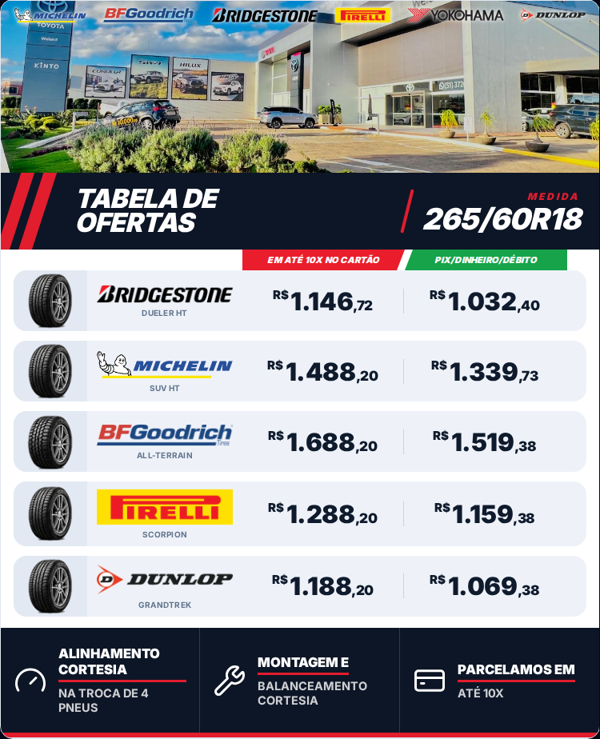
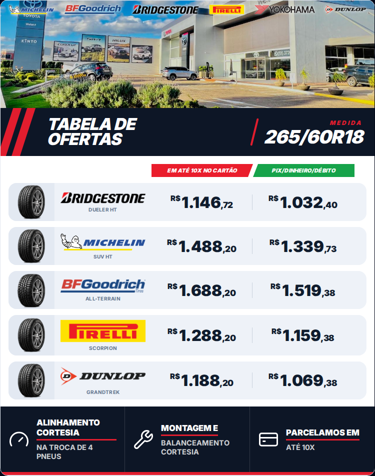
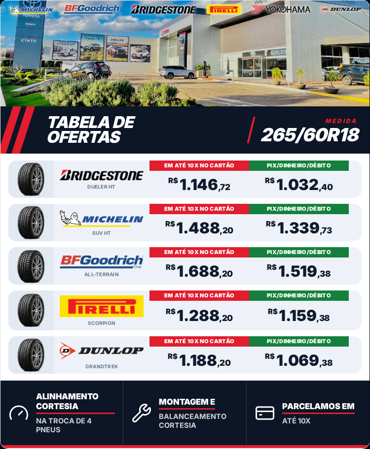
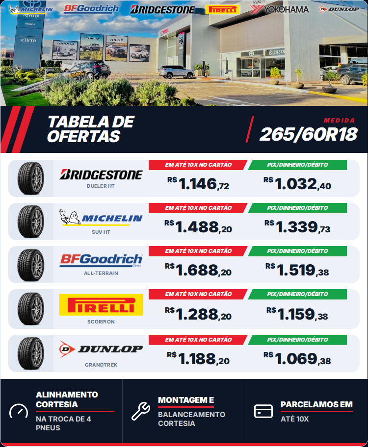
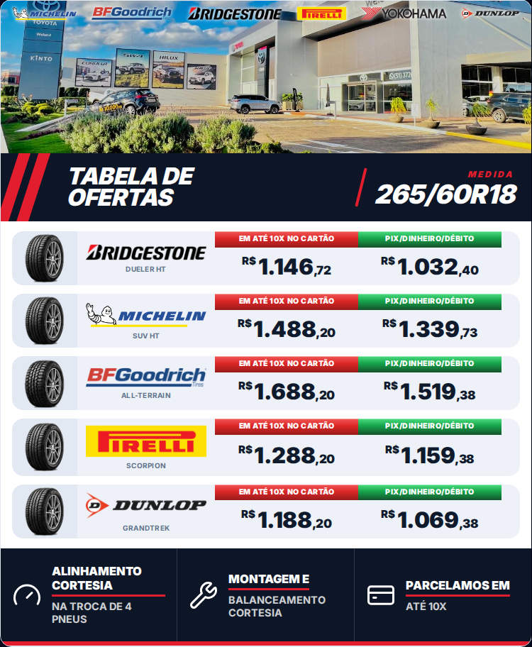
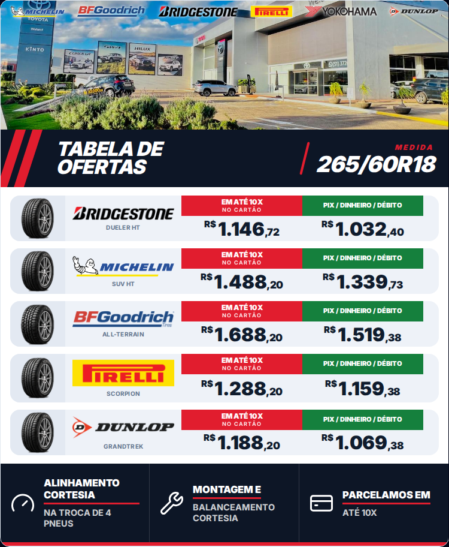

# Ideias — tarjas de preço da Vitrine da loja

No lugar do texto solto **"EM ATÉ 10X NO CARTÃO" / "À VISTA"** acima de cada valor:
**duas tarjas retangulares** — **vermelha com letra branca** para o cartão e **verde com letra
branca** para **"PIX/DINHEIRO/DÉBITO"**.

**Importante (correção do pedido):** as tarjas aparecem **uma única vez**, **como título das
colunas** — logo **abaixo da MEDIDA e acima dos primeiros valores** — e **as etiquetas saem de
dentro das linhas** (cada linha fica só com os valores). Cada tarja fica exatamente **em cima
da sua coluna** de preço (a vermelha sobre a coluna do 10x, a verde sobre a do à vista).

Simulações com os **dados de exemplo** (medida **265/60R18**), no tamanho real da saída
(**750px**). **Nada foi implementado** — o app continua igual (v0.147.0).

> Fonte **Inter** como substituta da fonte do sistema (como nos mockups antigos) — no seu PC
> vale a fonte do Windows.

---

## 02 como título de coluna (o formato que você pediu)

Estilo da **02** (itálico com corte diagonal no meio). Duas versões — escolha uma:

**A) Colada na tarja azul escura (sem espaço branco):** as tarjas emendam direto no azul da
MEDIDA e a primeira linha de valores encosta nelas.

**B) Com espacinho:** mantém o respiro branco normal entre a tarja azul, o título e a primeira
linha.

---

## Os 5 estilos de tarja (para escolher a "cara")

Estas 5 abaixo foram feitas **dentro de cada linha** só para comparar o estilo — na aplicação
final vale o formato "título de coluna" do topo desta página. Pode combinar
("a 4 com a cor da 5", "a 2 com a altura da 4"…).

## 01 — Sólido simples

As cores do próprio flyer (vermelho `#e11d2e` e verde `#15803d`), letra branca em negrito,
tarja baixa e reta. O jeito mais direto — quase a referência que você mandou.

## 02 — Itálico com corte diagonal

Tarja levemente mais viva, letra **itálica** e um **chanfro diagonal no meio** (o vermelho
termina em diagonal e o verde começa em diagonal, encaixando um no outro). Visual mais
"esportivo". **É a que você escolheu — já mostrada no formato final no topo.**

## 03 — Degradê com realce

Vermelho e verde em **degradê** (mais claro em cima) com um brilho fino de 1px no topo da
tarja — dá profundidade sem poluir.

## 04 — Duas linhas

Tarja um pouco **mais alta**: "EM ATÉ 10X" em cima e "NO CARTÃO" pequenininho embaixo (mesmo
retângulo); o verde fica na mesma altura com o texto centralizado. Sobra mais respiro para os
dígitos.

## 05 — Premium discreto

Tons **mais fechados** (vermelho e verde escuros) com **filete branco fino** por dentro e letra
mais espaçada. Mais "sóbrio", combina com o azul-marinho do banner.

